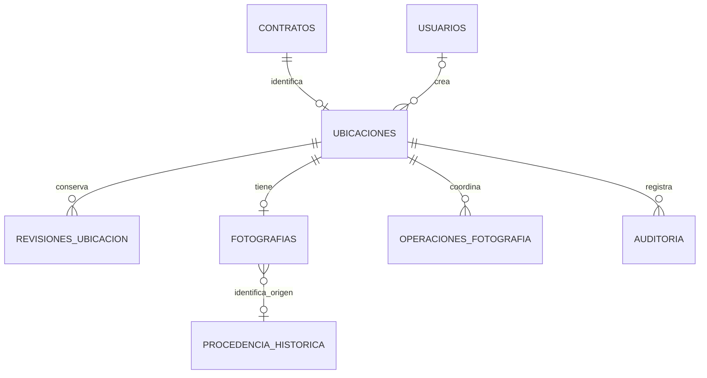

# GEO VISTA: API de usuarios y roles

Backend de autenticación y administración de cuentas. Las revisiones se
prueban en PostgreSQL local desechable; su estado debe verificarse por
separado en cada base. La instalación del esquema no crea cuentas reales.

## Preparación

Se requiere Python 3.11 o superior y PostgreSQL. Desde este directorio:

```sh
python3 -m venv .venv
.venv/bin/python -m pip install -e '.[test]'
.venv/bin/python -m pytest -q
```

Configurar `DATABASE_URL` por un mecanismo seguro, con el esquema
`postgresql+psycopg://` y TLS adecuado para el servidor. El backend y Alembic
cargan `backend/.env` si existe; una variable de entorno ya definida tiene
prioridad. El archivo está ignorado por Git y debe ser accesible solo al
usuario autorizado. No guardar la URL real ni contraseñas en archivos
versionados o registros.

Para Supabase, utilizar `sslmode=verify-full` y `sslrootcert` apuntando al
certificado raíz oficial descargado desde los ajustes de la base de datos.
Conservar ese certificado en una ubicación estable y protegida; no desactivar
la verificación TLS. La URL local debe especificar el controlador
`postgresql+psycopg://` y tener los caracteres especiales de la contraseña
codificados para URL. Los despliegues deben configurar sus propios secretos y
certificado, sin depender de rutas de una computadora de desarrollo.
Las conexiones Psycopg desactivan la preparación automática de sentencias
para ser compatibles con el pooler de Supabase en modo transacción.

El servicio no crea tablas
automáticamente. Una instalación nueva requiere aplicar las revisiones Alembic
**únicamente después de obtener autorización expresa**; no ejecutar
`downgrade`, que está bloqueado por ser destructivo. El SQL de diseño previo
no es una migración compatible con este módulo y no debe ejecutarse encima.

## Esquema PostgreSQL

`0001_users_roles` conserva cuentas, sesiones, roles, permisos y su auditoría.
`0002_locations` añade el esquema geográfico sin recrear esas tablas.
`0003_supabase_security` activa RLS sin políticas y retira los privilegios de
`PUBLIC`, `anon`, `authenticated` y `service_role` sobre las tablas,
secuencias y funciones propias de GEO VISTA. Los roles inexistentes se
omiten. La revisión no cambia privilegios predeterminados ni objetos ajenos.
`0004_historical_photos` permite registrar una importación histórica con
operador desconocido, procedencia confirmada y huellas original y optimizada.
`0005_panel_permissions` añade permisos de ubicaciones y asignaciones iniciales
para los roles existentes; también garantiza los permisos de usuarios
necesarios para gerente y jefe comercial.
`0006_photo_edit_permission` incorpora el permiso configurable de reemplazo de
fotografía y su requisito de consulta para los roles aprobados.
`0007_location_creation` agrega el creador y la fecha de creación de cada
ubicación. Recupera ambos solo cuando existe exactamente un evento de creación
de campo o administrativa con usuario en la auditoría; las demás ubicaciones
quedan con valores desconocidos. Un trigger impide modificarlos después.
`0008_update_reasons` agrega el catálogo de motivos, protegido mediante RLS y
revocación de privilegios para los roles de Supabase.
`0009_current_location_updates` copia la ubicación vigente desde la revisión
actual, conservando las revisiones anteriores, e incorpora el permiso
`ubicaciones.gps.editar` sin asignarlo a ningún rol. Añade la referencia al
motivo y la idempotencia a la auditoría. Los datos sin revisión vigente
conservan valores GPS nulos.
`0010_coordinate_methods` añade el método de coordenadas a la ubicación
vigente y a sus revisiones. Los valores existentes permanecen desconocidos;
no se atribuye una captura presencial a datos históricos.
Una actualización Alembic normal desde `0004` ejecuta las asignaciones de
`0005` y `0006`; no debe utilizarse cuando se haya decidido conservar
exactamente los permisos actuales sin preparar y verificar un procedimiento
transaccional específico.
`sql/esquema_postgresql.sql` es la salida de `alembic upgrade head --sql` para
una **base nueva y vacía**: incluye las once revisiones y `alembic_version`.
No ejecutar ese script sobre un esquema ya existente; para actualizar una
instalación existente se utiliza Alembic desde su revisión actual, previa
autorización y copia de seguridad. No ejecutar el SQL y Alembic como dos
instalaciones separadas en la misma base.

Las revisiones pendientes se aplican en una única transacción de PostgreSQL. Las
tablas no quedan accesibles desde los roles de la API de Supabase por los
privilegios explícitos eliminados, y RLS sin políticas deniega el acceso sujeto
a RLS. El propietario y los roles con `BYPASSRLS` pueden eludir RLS: mantener
las credenciales de conexión exclusivamente en el backend, verificar sus
permisos efectivos y no confiar en RLS para autorizar usuarios de FastAPI.
La revocación explícita es importante porque RLS no controla `TRUNCATE`.
Antes de una migración real hay que comprobar roles heredados, acceso efectivo,
respaldo y restauración; implementar políticas para otros clientes requeriría
una decisión separada. No se configuran políticas de Storage con esta revisión.

El SQL se puede regenerar desde este directorio con `DATABASE_URL` configurada
para el dialecto PostgreSQL, sin conectar al servidor:

```sh
.venv/bin/alembic upgrade head --sql > sql/esquema_postgresql.sql
```

### Tablas y relaciones

| Tabla / modelo | Propósito y relaciones |
|---|---|
| `roles` / `Role`, `permisos` / `Permission`, `rol_permisos` | Catálogo de roles y permisos; cada usuario tiene exactamente un rol y cada rol puede tener varios permisos. |
| `usuarios` / `User`, `sesiones` / `AuthSession`, `auditoria_usuarios` / `AuditEvent` | Cuentas, sesiones y auditoría del módulo existente. |
| `contratos` / `Contract` | `kardex` textual es clave primaria con colación `C`: se conserva sin normalización y solo se rechazan duplicados exactos y valores vacíos. |
| `ubicaciones` / `Location` | Como máximo una por contrato; conserva creador, fecha, coordenadas y método vigentes, y una versión para detectar cambios concurrentes. La referencia a revisión histórica debe pertenecer a la ubicación y estar cerrada. |
| `revisiones_ubicacion` / `LocationRevision` | Historial de URL, coordenadas y método; autor y fecha del evento histórico pueden ser desconocidos. Coordenadas juntas y dentro de sus rangos; las revisiones cerradas no se editan ni eliminan. |
| `fotografias` / `Photograph` | Una fotografía vigente como máximo por ubicación, con referencia al objeto, huella y usuario; en una importación histórica conserva además procedencia y huella original. No contiene la imagen. |
| `operaciones_fotografia` / `PhotoOperation` | Estado persistente, claves exactas, idempotencia e intentos para coordinación con Storage; `fotografia_id` es informativo, sin FK, para sobrevivir al borrado. |
| `motivos_actualizacion` / `UpdateReason` | Catálogo de motivos activos e inactivos; no se eliminan mediante la API. Los eventos conservan además el nombre del motivo al momento del cambio. |
| `actividades` / `Activity` | Actividades asociables a usuario y ubicación, con intervalos válidos. |
| `auditoria` / `AuditRecord` | Eventos geográficos inmutables; los eventos fotográficos conservan actor, ubicación, fecha e identificador informativo de la foto, sin depender de su existencia. |
| `procedencia_historica` / `HistoricalSource` | Ruta original, tipo, SHA-256 opcional, estado de revisión y kardex opcional. Una asociación solo debe establecerse tras confirmación; `PENDIENTE` no autoriza a inferir una asociación. |

No existe una tabla de clientes ni se normalizan los kardex. La FK de
procedencia comprueba que el contrato exista. Para el archivo histórico
específico, el usuario confirmó que cada carpeta principal representa un
kardex; el importador puede asociar sus archivos a ese contrato.
En una importación histórica automatizada `registrado_por` es nulo: no se
atribuye la carga a una persona que no se ha autenticado.



La fecha y el usuario de `ubicaciones` se establecen en el backend al iniciar
un registro de campo o administrativo, no los envía el cliente. Un registro
de campo puede quedar preparado pero incompleto si Storage falla; la fecha
representa la preparación inicial, no necesariamente la finalización. Los
valores recuperados de auditoría representan el evento registrado por el
servidor; no se atribuyen usuarios ni fechas originales desconocidas a las
importaciones históricas. El nombre mostrado corresponde al nombre actual
de la cuenta creadora.

En las listas de ubicaciones, `registro_pendiente` indica una operación activa
de creación de campo sin finalizar, incluida una que requiere revisión. La
comprobación exacta disponible a quien solo puede registrar también devuelve
ese indicador, sin revelar el creador ni la fecha. No indica que los registros
históricos sin foto o GPS estén pendientes. En otros endpoints el campo es
`null` porque no se consulta ese estado.

Las claves primarias y restricciones únicas indexan kardex, la ubicación por
contrato, la foto por ubicación, la clave de Storage y la idempotencia. El
índice parcial de operaciones impide dos operaciones activas por ubicación;
los índices por ubicación y fecha de revisiones, actividades y auditoría
facilitan el historial, los índices por usuario y fecha las consultas por
responsable, y los índices de fecha las consultas generales. Los índices por
ubicación de actividades y por kardex de procedencia facilitan sus relaciones;
el índice por permiso facilita la búsqueda inversa de roles.

### Fotografía, auditoría y Storage

Si la configuración de Storage se rechaza, los registros del backend indican
qué comprobación falló sin mostrar las URL, contraseñas ni claves. La respuesta
al navegador sigue siendo genérica. `SUPABASE_URL` debe ser la raíz HTTPS del
proyecto, sin `/storage/v1`; el backend añade esa ruta.

Los triggers de PostgreSQL exigen `app.usuario_id` para las modificaciones
ordinarias de fotografías. Como excepción, permiten crear una fotografía
histórica sin actor si su procedencia es una imagen confirmada para la misma
ubicación y su huella original coincide; registran un evento de importación
con procedencia y ambas huellas. Los triggers conservan el registro original y
escriben el evento de auditoría dentro de la misma transacción. La aplicación debe usar
`set_config('app.usuario_id', ..., true)` con el usuario autenticado y
verificar permisos en el backend. El contexto SQL no autentica por sí mismo:
los permisos de conexión y las funciones privilegiadas deben impedir que
clientes no confiables lo suplanten. La consulta de la foto oficial requiere
`ubicaciones.consultar`; el registro inicial requiere `ubicaciones.registrar`.
La sustitución requiere tanto `ubicaciones.consultar` como
`ubicaciones.fotografia.editar`; no permite agregar una foto donde no existe.
La edición de GPS requiere `ubicaciones.consultar` y `ubicaciones.gps.editar`;
para modificar ambos se necesitan los tres permisos. El administrador mantiene
su acceso existente. La administración de motivos se limita a administrador,
gerente, jefe comercial y jefe operativo.

Cada actualización exige un motivo activo y admite observación opcional. Se
guardan el GPS vigente, la referencia fotográfica y un evento textual en la
misma transacción PostgreSQL; el evento conserva kardex, usuario, fecha, nombre
del motivo y elementos modificados, sin guardar coordenadas anteriores ni
copias de fotografías. Las revisiones históricas se conservan sin añadir
revisiones en este flujo. El historial es consultable por quienes pueden
consultar la ubicación; el trigger existente impide modificarlo o borrarlo.
Al actualizar GPS se borra la URL vigente anterior, que permanece en su
revisión histórica si procedía de ella. Las nuevas capturas registran método,
coordenadas, precisión, fecha de medición y responsable; el historial conserva
los datos de la actualización. Las anteriores siguen con calidad desconocida.

El registro inicial exige seleccionar `GPS_DISPOSITIVO` o
`ENLACE_COMPARTIDO`, confirmar las coordenadas y adjuntar una fotografía válida.
La API exige ahora `metodo_coordenadas` y `coordenadas_confirmadas: true`;
los clientes anteriores deben actualizarse antes de registrar nuevas
ubicaciones. El backend y el frontend deben desplegarse coordinadamente.
Para GPS se requieren `precision_metros` y `capturado_en`, y se rechazan
mediciones superiores al límite aceptable. Para enlaces estos campos son nulos:
la fecha original y la precisión del dispositivo que compartió el enlace no se
conocen. La revisión inicial conserva `fecha_evento` como fecha de medición GPS,
además de `registrado_en`; los reintentos de operaciones antiguas ya preparadas
conservan precisión desconocida. La migración `0011` agrega columnas anulables
sin rellenar ni modificar datos históricos.

Los límites `GPS_LIMITE_EXCELENTE`, `GPS_LIMITE_BUENA`,
`GPS_LIMITE_ACEPTABLE` y `GPS_LIMITE_BAJA` se configuran en metros en el
backend; por defecto son 5, 10, 20 y 50, respectivamente. Deben ser positivos
y estrictamente crecientes. La API los entrega al frontend en
`GET /configuracion-gps`. Son criterios orientativos: la precisión y hora son
declaraciones del dispositivo, no pruebas independientes. Cambiar límites puede
hacer que una captura en curso sea rechazada; en ese caso se debe repetir.
La procedencia es una declaración del usuario, no una prueba criptográfica de
presencia. El servidor interpreta enlaces HTTPS de Google Maps con coordenadas
puntuales y marcadores `mlat`/`mlon` de OpenStreetMap. Los enlaces cortos de
`maps.app.goo.gl` y `goo.gl/maps/` se resuelven con destinos permitidos,
TLS verificado y direcciones públicas comprobadas y fijadas a la conexión.
Se rechazan ubicaciones ambiguas o no reconocidas; no se interpreta el centro
de un mapa como domicilio. La vista previa se solicita nuevamente antes de
preparar un registro compartido; después de prepararlo, los reintentos usan
la revisión guardada y comprueban que método, URL y demás datos coincidan.
Borradores anteriores requieren confirmar el origen; si ya hay una revisión
cerrada pendiente, se conserva y se crea otra con el origen confirmado.

Storage y PostgreSQL no comparten transacciones. El importador histórico
implementa la creación recuperable descrita más abajo. El registro de campo
también prepara una operación persistente, serializa los reintentos por
operación, verifica la huella del objeto y solo entonces publica la foto y
revisión. Las claves existentes nunca se sobrescriben. Un fallo deja la
operación pendiente para reintentar con los mismos datos; si se descarta el
borrador del navegador, puede ser necesaria una revisión manual. El reemplazo
serializa operaciones por ubicación, comprueba la versión observada, sube y
verifica una clave nueva, y publica la referencia y el estado de limpieza
en una transacción. Antes de borrar la clave anterior comprueba que no sea una
foto vigente y después verifica su ausencia. La operación y la auditoría
conservan las referencias y huellas, pero la imagen anterior se elimina
definitivamente, incluso si es una copia histórica. El RAR original y la
procedencia no se modifican. Si falla el borrado se informa
`pendiente_limpieza`, no un borrado exitoso.

El contenedor activa `VISTAGEO_PHOTO_CLEANUP_ENABLED=true` para reintentar cada
60 segundos los reemplazos pendientes mientras el servicio está en ejecución.
En modo Python separado configurar esa variable explícitamente. Si el servicio
está detenido, los reintentos se reanudan cuando vuelva a ejecutarse. También
se puede reintentar desde el borrador del navegador con la misma operación.
El recuperador no procesa operaciones de importación histórica ni elimina
objetos cuyo uso como fotografía vigente encuentre en la base.

### Pruebas de PostgreSQL

Las pruebas `tests/test_postgresql_schema.py` solo se ejecutan si se define
`TEST_DATABASE_URL` para una **base desechable** con todas las revisiones ya
aplicadas. Insertan datos de prueba dentro de transacciones revertidas, pero
las secuencias pueden avanzar; nunca apuntarlas a una base real. Sin esa
variable se omiten. Las pruebas verifican kardex exactos, procedencia,
revisiones, fotografía, auditoría, operaciones y un flujo básico de usuarios
y roles de la API. No sustituyen pruebas de carga real de Storage.
Para comprobar la restricción de los roles Supabase, la base desechable debe
contener los roles `anon`, `authenticated` y `service_role`; si no existen,
esa prueba se omite.

Una vez aprobado y preparado el esquema, la inicialización de la primera
cuenta es una acción separada que requiere autorización:

```sh
.venv/bin/python -m app.bootstrap
```

El comando solicita la contraseña dos veces sin mostrarla, requiere que no
existan usuarios y crea `JUNIOR` con rol `ADMINISTRADOR`. La cuenta debe
cambiar la contraseña en el primer acceso. No pasar contraseñas como
argumentos, variables de entorno, ejemplos de código ni archivos.

```sh
.venv/bin/uvicorn app.main:app
```

Consultar la documentación interactiva en `/docs` en un entorno seguro.
Utilizar HTTPS para credenciales y tokens; para una instalación compartida,
no exponer el servicio directamente sin configurar su entorno de seguridad.

## Autenticación

`POST /auth/login` recibe `username` y `password` y devuelve un token Bearer.
Las credenciales se convierten a mayúsculas Unicode; la contraseña se
almacena como hash Argon2 y nunca se devuelve. El token es aleatorio, se
almacena solo su huella y debe conservarse de forma segura. Para una
contraseña temporal, la respuesta indica `must_change_password: true`: solo
se permiten `/auth/me`, `/auth/password` y `/auth/logout` hasta cambiarla.
Cambiar la contraseña revoca las sesiones y requiere iniciar sesión otra vez.
Las cuentas nuevas creadas mediante `/usuarios` pueden usar su contraseña
inicial sin cambiarla; el cambio propio es opcional. Esta regla no modifica
cuentas existentes ni el cambio obligatorio tras un restablecimiento.

Una sesión vence a los 10 minutos sin actividad. El cliente debe enviar
`X-Actividad-Usuario: true` **solo** cuando una petición representa una
acción deliberada del usuario. Las consultas automáticas no deben incluirlo;
las solicitudes sin esa cabecera no prolongan la sesión. La API rechaza
sesiones vencidas incluso si la interfaz sigue abierta.

`GET /auth/me` incluye el nombre y los permisos del rol propio, incluso
durante el cambio obligatorio de contraseña, sin conceder acceso a `/roles`.

Cinco intentos fallidos bloquean esa cuenta durante 15 minutos. Las respuestas
de cuenta inexistente, desactivada, bloqueada o con contraseña incorrecta
son iguales. Esta protección por cuenta puede ser usada para bloquear
temporalmente a otra persona; monitorear los eventos. No limita intentos de
nombres inexistentes ni sustituye una protección adicional de tráfico en el
despliegue.

## Endpoints

| Método | Ruta | Uso |
|---|---|---|
| POST | `/auth/login` | Iniciar sesión. |
| GET | `/auth/me` | Consultar la cuenta de la sesión. |
| POST | `/auth/password` | Cambiar la contraseña propia. |
| POST | `/auth/logout` | Revocar la sesión actual. |
| GET, POST | `/usuarios` | Consultar o crear usuarios. |
| GET, PATCH | `/usuarios/{id}` | Consultar o editar usuario, rol y estado. |
| POST | `/usuarios/{id}/restablecer-contrasena` | Establecer contraseña temporal y revocar sesiones. |
| GET, POST | `/roles` | Listar o crear roles. |
| PATCH | `/roles/{id}` | Renombrar un rol no protegido. |
| GET | `/permisos` | Consultar el catálogo de permisos del módulo. |
| PUT | `/roles/{id}/permisos` | Reemplazar los permisos de un rol. |
| GET, POST | `/contratos` | Listar, buscar por kardex exacto o registrar un contrato confirmado. |
| GET, POST | `/ubicaciones` | Listar o buscar por kardex exacto o parcial y crear la ubicación de un contrato confirmado. |
| GET | `/ubicaciones/{id}` | Consultar una ubicación. |
| POST | `/registro-ubicacion` | Crear contrato si falta, ubicación, revisión y fotografía oficial mediante operación idempotente. |
| GET | `/ubicaciones/{id}/fotografia` | Descargar la foto privada vigente con permiso de consulta. |
| PUT | `/ubicaciones/{id}/fotografia` | Reintentar limpieza o confirmar el resultado de un reemplazo anterior ya publicado; no inicia cambios nuevos. |
| PUT | `/ubicaciones/{id}/actualizacion` | Actualizar foto, GPS o ambos con motivo obligatorio e idempotencia. |
| GET | `/ubicaciones/{id}/actualizaciones` | Consultar el historial textual de actualizaciones. |
| GET | `/ubicaciones/{id}/revisiones` | Consultar las revisiones históricas. Crear revisiones mediante POST ya no está disponible. |
| GET, POST | `/motivos-actualizacion` | Listar motivos activos para consulta o crear motivos como gestor. `?todos=true` exige ser gestor. |
| PUT | `/motivos-actualizacion/{id}` | Editar y activar o desactivar un motivo como gestor. |
| GET | `/procedencia`, `/procedencia/{id}` | Consultar el inventario histórico, solo como administrador. |
| PUT, DELETE | `/procedencia/{id}/contrato` | Confirmar, corregir o retirar manualmente la asociación con un contrato. |

La consulta de contratos y ubicaciones requiere `ubicaciones.consultar`;
`ubicaciones.registrar` permite consultar por kardex exacto para evitar
duplicados y registrar una ubicación oficial. La gestión histórica y los
endpoints individuales de creación y edición siguen siendo de administrador.
La búsqueda y ficha con permiso de consulta incluyen `creado_en` y
`creado_por_nombre`; pueden ser nulos para datos anteriores desconocidos.
La consulta exacta autorizada solo para registro no divulga esos metadatos.
El kardex se conserva exactamente; se rechazan duplicados exactos.
`GET /ubicaciones?kardex_contiene=texto` busca una parte literal sin distinguir
mayúsculas de minúsculas; los espacios y caracteres `%`, `_` y `/` son
literales. No se puede combinar con `kardex`, que continúa siendo exacto.
La búsqueda parcial exige `ubicaciones.consultar` y devuelve páginas por ID
con `limit` y `offset`. En PostgreSQL utiliza la colación ICU `und-x-icu`,
que debe estar disponible; SQLite de pruebas solo compara letras ASCII sin
distinguir mayúsculas.
Las revisiones históricas se conservan. Las listas admiten `limit` (máximo 500)
y `offset`.
La foto se obtiene desde el servidor con `SUPABASE_URL` y
`SUPABASE_SECRET_KEY`, sin compartir la clave ni hacer público el bucket.
Si hay huella almacenada se verifica antes de entregar los bytes; una
referencia rota o huella incorrecta devuelve error, no una foto inexistente.
La respuesta de la foto incluye `X-Foto-Version`. El PUT de actualización
recibe `idempotencia` (UUID), `version` de la ubicación, `motivo_id`,
`observacion` opcional y latitud y longitud juntas y/o `fotografia_base64`
con `foto_version` de la cabecera. Una versión obsoleta devuelve 412 sin
publicar cambios. Repetir la misma operación y datos permite recuperarse tras
una interrupción. El estado `pendiente_limpieza` indica que la imagen nueva es
vigente, pero la eliminación de la anterior aún no está confirmada. Un borrador
antiguo no publicado puede completarse con motivo desde la nueva interfaz;
si el motivo de una operación pendiente se desactiva, debe reactivarse para
reintentarla con los mismos datos.

Antes de desplegar se requiere copia de seguridad, verificar la revisión
existente y autorizar por separado las migraciones. Coordinar una ventana sin
escrituras de versiones antiguas de la aplicación: después de copiar el GPS
no deben crearse revisiones nuevas con código antiguo. Revisar operaciones
pendientes, aplicar y comprobar el esquema, desplegar backend y frontend de
la misma versión, crear motivos y asignar el permiso GPS explícitamente a los
roles aprobados. No se asigna automáticamente a técnicos ni a otros roles.

## Conexión del frontend y Render

### Un solo Web Service

La opción unificada conserva FastAPI y publica React y la API desde el mismo
origen. El `Dockerfile` de `vistageo/` compila el frontend con
`VITE_API_URL=/api`; `app.unified:app` monta la API bajo `/api`, sirve sus
archivos estáticos y devuelve la aplicación para las rutas de React. La
documentación de la API queda en `/api/docs`. Las URLs antiguas de API sin
prefijo corresponden al modo separado descrito más abajo, no al unificado.
Los archivos del service worker no cachean respuestas de `/api`.

En Render, usar runtime **Docker**, raíz `vistageo` y ruta al Dockerfile
`./Dockerfile` relativa a esa raíz. Al cambiar el servicio existente desde
Settings → Source, comprobar esos valores antes de desplegar. El comando de
inicio está en el Dockerfile; no se requieren Node ni un Static Site aparte.
La imagen no contiene `.env`, certificados ni datos históricos.

Configurar en el servicio `DATABASE_URL`, `SUPABASE_URL` y
`SUPABASE_SECRET_KEY` de forma privada. La URL PostgreSQL debe conservar
`sslmode=verify-full` y `sslrootcert` apuntar a un certificado presente en
Render, por ejemplo `/etc/secrets/supabase-ca.crt` si se configuró como
Secret File. La ruta local del equipo de desarrollo no existe en Render.
No se ejecutan migraciones ni se comprueba la conexión al iniciar. Si se usa
el frontend y la API desde el mismo origen, no se necesita configurar CORS;
mantener orígenes anteriores únicamente si se pretende conservar acceso desde
otro frontend. Para volver al modo separado, usar el runtime Python y la
configuración siguiente.
Antes de habilitar edición hay que revisar y autorizar por separado `0006`
en la base de destino. El despliegue no aplica esa revisión.
La revisión `0007` también requiere autorización separada y una copia de
seguridad restaurable. Para evitar registros sin metadatos durante el cambio,
detener las escrituras mientras se aplica `0007` y se despliega el backend
compatible; comprobar la versión y los flujos antes de reanudarlas.

### Dos servicios

Para orígenes diferentes, configurar `CORS_ORIGINS` en el entorno del backend
con una lista separada por comas de orígenes exactos (sin rutas ni barra
final), por ejemplo `http://localhost:5173`. En Render usar el origen HTTPS
real del sitio frontend; no usar `*`. Reiniciar el backend después de
cambiarlo. Las variables del proceso prevalecen sobre el `.env` local.

En Render crear un **Web Service** Python con raíz `vistageo/backend`:
comando de build `pip install .` y comando de inicio
`uvicorn app.main:app --host 0.0.0.0 --port $PORT`. Configurar de forma
privada `DATABASE_URL`, `SUPABASE_URL`, `SUPABASE_SECRET_KEY` y
`CORS_ORIGINS` en Render. Para PostgreSQL conservar `sslmode=verify-full`
y configurar `sslrootcert` con una ruta de CA disponible en el servicio
que verifique el certificado usado por la conexión Supabase. Confirmar esa
ruta y conectividad en el entorno de despliegue. No aplicar migraciones ni
crear usuarios automáticamente al iniciar el servicio. Ver las instrucciones
del sitio estático en el README del frontend.

La aplicación todavía requiere revisión operativa de seguridad antes de
exponerla públicamente: límites de tráfico, protección contra XSS y gestión
de tokens almacenados en el navegador, supervisión y recuperación. El inicio
de sesión por sí solo no proporciona protección contra ataques distribuidos.

Ejemplo, con token de administrador que ya cambió su contraseña temporal:

1. `POST /contratos` con `{"kardex": "123-1"}`.
2. `POST /ubicaciones` con `{"kardex": "123-1"}`; guardar el `id` devuelto.
3. `POST /ubicaciones/{id}/revisiones` con
   `{"latitud": -16.5, "longitud": -68.1}` o `{"url_gps": "https://maps.example/ubicacion"}`.
4. `GET /ubicaciones/{id}/revisiones` consulta el historial.

## Inventario histórico

El comando requiere `7z` y `libarchive.so.13` instalados en el sistema.
Primero se ejecuta sin `--aplicar` para simular la carga: lee el RAR en
streaming, comprueba los tamaños y CRC contra el listado independiente y
calcula SHA-256 sin extraer ni modificar el archivo. Solo después de revisar
el resultado y confirmar la base de destino se puede repetir con
`--aplicar --sha256-esperado <SHA256> --cantidad-esperada <CANTIDAD>`.
La huella y cantidad deben coincidir exactamente con la simulación.

La carga se realiza en una sola transacción, con bloqueo de tabla, y se
rechaza si ya hay registros en `procedencia_historica`. Solo guarda ruta
original, tipo según extensión, huella y estado `PENDIENTE`: no sube
documentos ni imágenes, no importa URLs ni crea contratos, ubicaciones o
asociaciones. Registra una auditoría de la carga con la huella del archivo;
el actor es desconocido porque el comando local no autentica al operador.
Un fallo revierte la transacción; si se pierde la conexión al confirmar,
verificar el estado y la auditoría antes de reintentar.

Para revisar el inventario, un administrador puede consultar
`GET /procedencia` con filtros opcionales `carpeta`, `estado`, `tipo` o
`kardex`, y paginar con `limit` y `offset`. `carpeta` es una ruta original
exacta; también incluye archivos en sus subcarpetas. La API devuelve metadatos,
no el contenido de documentos o imágenes.

Después de confirmar manualmente el contrato, se registra el kardex exacto en
`contratos` y se llama `PUT /procedencia/{id}/contrato` con
`{"kardex": "123-1"}`. El contrato debe existir y la procedencia pasa a
`CONFIRMADO`; repetir la misma petición no crea otra auditoría. Una nueva
confirmación permite corregir el kardex, y `DELETE /procedencia/{id}/contrato`
retira la asociación y devuelve la procedencia a `PENDIENTE`, sin borrar el
archivo ni el inventario. Los cambios se registran con actor y valores antes
y después. `CONFIRMADO` se refiere únicamente a la asociación con el contrato:
no confirma que una foto o URL sea vigente y no crea ubicaciones ni sube fotos.

### Contratos y enlaces históricos

Tras inventariar el archivo y confirmar la regla de carpetas, ejecutar
`python -m app.migrar_kardex <RAR>` sin `--aplicar` para simular los
contratos y ubicaciones. Para guardar, añadir `--aplicar` junto con
`--sha256-esperado`, `--kardex-esperados` y `--archivos-esperados` obtenidos
de la simulación. El comando comprueba el inventario existente, preserva los
kardex exactos y asocia los archivos de cada carpeta en una transacción.

Luego, `python -m app.migrar_ubicaciones <RAR>` simula la selección del
primer enlace de Google Maps por carpeta, en orden del archivo y del
documento. Para guardar, repetir con `--aplicar`, `--sha256-esperado`,
`--archivos-esperados` y `--ubicaciones-esperadas` de la simulación.
El proceso verifica el inventario y sus asociaciones, conserva las
ubicaciones que ya tienen una revisión vigente y registra las revisiones
históricas cerradas con responsable desconocido. Solo se guardan coordenadas
si son explícitas y válidas. Las operaciones son transaccionales y
repetibles; no cargan documentos ni fotos a Storage.

### Optimización local de fotografías históricas

El optimizador trabaja únicamente con archivos locales; no usa PostgreSQL,
no sube a Storage y no modifica los originales. Requiere las dependencias del
backend, incluyendo Pillow con soporte WebP, además de `7z` y `libarchive`.
Ejemplo desde `backend`, con una salida nueva fuera de `dataAntigua`:

```sh
.venv/bin/python -m app.optimizar_fotografias \
  '../../dataAntigua/UBICACION DE CLIENTES.rar' \
  '../../fotografias-historicas-optimizadas'
```

Procesa todas las imágenes por separado con orientación EXIF, sin ampliación,
en WebP calidad 80 y hasta 1600 × 1600, eliminando metadatos. El CSV conserva
el kardex exacto y la ruta original; los nombres de salida son huellas de
las rutas originales. Las copias idénticas se señalan en `duplicado_de`, pero
no se eliminan ni se fusionan. El manifiesto local `estado.sqlite3` permite
reanudar con la misma fuente, configuración y versión de Pillow. Cada
resultado existente se comprueba por huella y decodificación: si fue alterado
se informa como fallo, sin sobrescribirlo. La salida debe ser exclusiva del
proceso y conservarse completa para reanudar. Las imágenes de más de 50 MiB,
vacías o dañadas se registran como fallidas y no detienen las demás.
Las imágenes con múltiples fotogramas se rechazan para evitar perder cuadros.
El comando termina con código distinto de cero cuando hay imágenes fallidas,
aunque haya terminado y creado los informes.

Cada ejecución completa crea un nuevo CSV y resumen JSON. El resumen cuenta
las procesadas, las omitidas por reanudación y las fallidas; el porcentaje de
ahorro compara únicamente originales convertidos correctamente con sus
resultados. Una reducción negativa significa que WebP ocupó más espacio.
Las interrupciones conservan el estado por imagen; ejecutar de nuevo el mismo
comando para reanudar. La integridad del RAR se comprueba antes y después y
se contrastan las entradas con tamaño y CRC. Un informe no se genera si falla
la verificación global: no utilizar resultados incompletos para una carga.
La salida contiene fotografías de clientes y debe protegerse como los originales.
No agregar las fotografías, el estado ni los informes al control de versiones.

### Carga histórica a Storage

El comando `python -m app.migrar_fotografias <RAR> <SALIDA> <INFORME.csv>`
simula la carga. Verifica huellas, inventario, procedencias confirmadas,
ubicaciones, estado local y apertura de los WebP; selecciona la primera imagen
de cada carpeta en orden del RAR. Si esa imagen falló, no selecciona otra:
queda pendiente de revisión. No sube documentos ni reemplaza fotos existentes.

Para aplicar, tras revisar la simulación y el destino, repetir con `--aplicar`,
`--sha256-esperado`, `--candidatas-esperadas` y `--fallidas-esperadas`.
El `.env` local debe contener `SUPABASE_URL` y `SUPABASE_SECRET_KEY`, y
`DATABASE_URL` debe apuntar al mismo proyecto con TLS `verify-full` y raíz
configurada. El bucket privado `fachada` debe existir y disponer de capacidad.
No compartir ni incluir credenciales en comandos o archivos versionados.

El cargador guarda primero una operación en PostgreSQL, sube sin sobrescribir
y descarga el objeto para comprobar su SHA-256 antes de registrar la foto y
cerrar la operación. PostgreSQL conserva la huella del WebP y la del original.
Una interrupción deja la operación recuperable; repetir el mismo comando
verifica el objeto remoto antes de continuar. Si una foto vigente aparece
durante la carga, no se reemplaza: la operación queda `pendiente_limpieza` y
el comando se detiene. No elimina objetos automáticamente; una limpieza
pendiente requiere revisión y comprobación de que la clave no esté en uso.
Los errores temporales de conexión se reintentan con esperas crecientes y un
límite; si persisten, el comando informa el fallo y puede reanudarse después.
El importador no reemplaza fotos existentes; el flujo de reemplazo del panel
es independiente del importador.

## Catálogo oficial y limpieza controlada

Los roles oficiales son `ADMINISTRADOR`, `GERENCIA`, `JEFE OPERATIVO`,
`JEFE TECNICO` y `TECNICO`. La API permite crear únicamente estos nombres y
no permite renombrarlos. La inicialización de una base vacía crea los cinco.
Durante la transición, `GERENTE` conserva sus controles previos hasta que se
renombre a `GERENCIA`.

En una instalación existente, la limpieza es un procedimiento separado, no
una migración Alembic automática. Antes de ejecutarlo, verificar la base de
destino, su revisión Alembic, una copia de seguridad y su restauración; detener
la aplicación durante la revisión y aplicación. Desde `backend`:

```sh
.venv/bin/python -m app.limpiar_roles
```

El informe identifica los roles, los usuarios candidatos de `CAJERO`,
`CALL CENTER` y `JEFE COMERCIAL`, y sus referencias. Revisar y confirmar que
cada usuario candidato sea realmente de prueba. Si hay un rol no previsto,
un conflicto entre `GERENTE` y `GERENCIA`, ausencia de administrador activo o
alguna referencia de un usuario o rol retirado, el procedimiento se detiene:
no borra sesiones, auditorías, ubicaciones ni otros registros.

Solo después de revisar el informe, repetir con `--aplicar` y un `--usuario-id`
por cada candidato aprobado. Si no hay candidatos, usar únicamente
`--aplicar`. La lista debe coincidir exactamente con los candidatos del informe
actualizado. La aplicación es transaccional: elimina solo los candidatos y
roles indicados, renombra `GERENTE` conservando su ID y permisos, crea roles
oficiales ausentes y registra el resultado en auditoría. No toca contraseñas,
fotografías, ubicaciones ni historiales. Si falla cualquier operación, se
revierte la transacción completa. No se eliminan roles desde la API.

El procedimiento conserva los permisos de los roles existentes; los roles
creados en una base existente empiezan sin permisos. Por tanto, no garantiza
que todos los usuarios puedan consultar ubicaciones: esto depende de
`ubicaciones.consultar`, que debe revisarse por separado. Tampoco limita el
alcance de ubicaciones por usuario. El catálogo incluye `usuarios.consultar`,
`usuarios.gestionar`, `roles.consultar`, `roles.gestionar`,
`ubicaciones.consultar`, `ubicaciones.registrar`,
`ubicaciones.fotografia.editar` y `ubicaciones.gps.editar`. El administrador
tiene acceso completo. Los controles existentes siguen permitiendo a
`GERENCIA` y `JEFE OPERATIVO` modificar permisos; no se han redistribuido.

`usuarios.gestionar` permite crear usuarios, asignar roles no administradores,
editar y restablecer contraseñas. Otorgarlo incluye esas facultades y debe
hacerse cuidadosamente. Solo los gestores de permisos pueden asignar roles de
gestor o modificar/restablecer cuentas con esos roles; solo el administrador
puede hacerlo para cuentas administradoras. No se puede desactivar ni quitar
el rol del último administrador activo. El
restablecimiento de identidad y la entrega de
la contraseña temporal se realizan por un canal seguro externo a la API; el
administrador debe verificar primero la identidad.

## Ejemplos de uso

Los siguientes cuerpos son ejemplos para `/docs` u otro cliente HTTPS. Los
valores entre `<...>` son marcadores: no usar contraseñas reales en comandos
de shell, capturas, registros ni documentación.

1. `POST /auth/login`:

   ```json
   {"username": "JUNIOR", "password": "<CONTRASEÑA>"}
   ```

   Si se exige cambio, usar el token devuelto en la autorización Bearer de
   `/docs` y llamar `POST /auth/password`:

   ```json
   {"current_password": "<TEMPORAL>", "new_password": "<NUEVA_CONTRASEÑA>"}
   ```

   Después iniciar sesión nuevamente.

2. `GET /roles` devuelve los identificadores de roles. Para crear una cuenta,
   `POST /usuarios`, sustituyendo el marcador por el ID **numérico** del rol
   técnico obtenido en esa respuesta:

   ```json
   {"username": "TECNICO1", "password": "<CONTRASEÑA_INICIAL>", "role_id": "<ID_DEL_ROL_TECNICO>"}
   ```

   La persona usuaria puede cambiar la contraseña inicial cuando lo desee.

3. Para autorizar consultas de usuarios a un rol, un gestor de permisos
   autorizado llama `PUT /roles/{id}/permisos`:

   ```json
   {"permissions": ["usuarios.consultar"]}
   ```

   Esta operación reemplaza la lista completa. Para desactivar una cuenta,
   `PATCH /usuarios/{id}` con `{"active": false}`. Para restablecer la
   contraseña, usar `POST /usuarios/{id}/restablecer-contrasena` con el campo
   `temporary_password`; la sesión anterior se revoca.

Los errores usan códigos HTTP como 401, 403, 404, 409 y 422. Las respuestas
de validación no devuelven los valores recibidos, para no reflejar contraseñas.

## Límites pendientes

- Las pruebas de la API utilizan SQLite en memoria; las de esquema requieren
  PostgreSQL desechable. Las pruebas automatizadas simulan Storage y no
  cubren todas las condiciones de concurrencia o fallos de producción.
- Las diferencias de conversión Unicode entre el frontend y el backend
  deben comprobarse antes de integrar la interfaz. El backend usa la
  conversión Unicode de Python y no elimina espacios de las contraseñas.
- Es necesario definir permisos mínimos de base de datos, TLS, despliegue y
  retención de auditoría. El trigger de auditoría preparado para PostgreSQL
  no impide que un propietario privilegiado lo deshabilite.
- La constitución existente aún debe reconciliar sus nombres de roles con los
  confirmados. La API no cambia automáticamente esa constitución.
